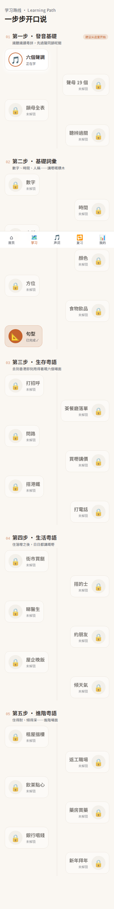
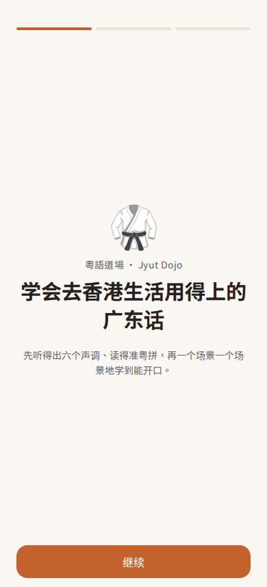

# 粵語道場 Jyut Dojo

**为普通话母语者做的粤语学习 App** —— 专治「普通话耳朵听不出的音和调」。
纯静态 PWA + 安卓 App，界面简体中文，教学内容是地道香港口语粤语。

🌐 在线体验：**https://jyut.benbox.dev** · 📱 安卓 APK 见 [Releases](../../releases)

<p align="center">
  
  
  
</p>

## 为什么做这个

市面上的粤语课基本是「英语母语者视角」或纯词汇堆砌。普通话母语者的真正难点很具体：

- **6 个声调**（普通话只有 4 个），尤其第 2 声 vs 第 5 声、第 3 声 vs 第 6 声几乎听不出差别
- **普通话没有的音**：`ng-` 起音、`gw/kw` 圆唇、长短 `a` 对立、`oe/eoi` 韵母
- **口语 ≠ 书面语**：佢、嘅、喺、冇、咗、係、唔 —— 把普通话句子换成粤拼不是粤语
- **语序陷阱**：「畀个餐牌我」(给菜单我) 和普通话相反

这个 App 的每一块都围绕这些点设计。

## 功能

**学习路线** 五阶段闯关，逐关解锁（也可跳过）
- 第一步 · 发音基础：六声调可视化 + 19 声母 + 45 韵母（每个都标注普语者陷阱）+ 自适应听辨训练
- 第二步 · 基础词汇：数字/时间/人称/颜色/方位/食物 六组词卡 + **10 张句型语法卡**
- 第三～五步 · 生存/生活/进阶粤语：**18 个情景对话**（茶餐厅、问路、看医生、租房、职场、拜年…）

**每课学习闭环** 学 → 练 → 测
- **学**：对话气泡，逐字点读，可展开普通话对照，命中语法点显示「句型」提示
- **练**：听音复述 + 自评，可内嵌跟读录音打分（声调相似度，实验功能）
- **测**：15 题 5 种题型 —— 听音选句 / 粤拼排序 / 对话接龙 / 填空 / **听写**

**巩固**
- SM-2 间隔重复（学过的词自动入卡组）
- 错题本（答错自动收录，重练对两次才消）
- XP / 每日目标 / 连续打卡 / 30 天热力图 / 声调准确率分析

**其他**：云端同步（同步码，无需注册）· 慢速播放 · 男女双声 · 安卓每日提醒 · 离线可用（PWA）

## 技术栈

| 层 | 选型 |
|---|---|
| 前端 | React 18 + TypeScript (strict) + Vite + Tailwind CSS |
| 状态 | Zustand + localforage (IndexedDB)，纯本地优先 |
| 音频 | 构建期用 Microsoft Edge TTS (`zh-HK-HiuMaanNeural` / `WanLungNeural`) 批量生成静态 mp3，**运行时零 TTS 调用** |
| 音高分析 | Web Audio API + [pitchy](https://github.com/ianprime0509/pitchy)(YIN) + DTW 相似度 |
| 打包 | vite-plugin-pwa（离线）+ Capacitor（安卓） |
| 后端 | 可选的同步/统计服务：单文件 Node + `node:sqlite`，**零依赖** |
| 测试 | vitest，80 个单元测试（SRS 调度、路径解锁、合并逻辑、听写判分、音高打分…） |

## 快速开始

```bash
npm install
npm run validate    # 校验教材数据（见下）
npm run gen-audio   # 生成 677 个 mp3（需 pip install edge-tts；仓库已含音频，可跳过）
npm run dev         # 开发
npm run build       # 产出 dist/（纯静态，可部署到任何地方）
npm test            # 单元测试
```

`dist/` 可直接部署到 Vercel / Cloudflare Pages / 任意静态服务器，也可解压后双击
`index.html` 离线使用（HashRouter + 相对路径）。**录音功能需要 https 或 localhost**
（浏览器安全限制）：本地可跑 `python -m http.server -d dist 8080`。

### 安卓打包

```bash
npm run build && npx cap sync android
cd android && ANDROID_HOME=~/Android/Sdk ./gradlew assembleRelease
# 然后 zipalign + apksigner 用你自己的 keystore 签名
```

### 可选：同步 + 统计服务

```bash
cd server
ADMIN_KEY=<至少12位随机字符串> DB_PATH=./jyut.db node server.mjs
```
前端通过 `src/lib/api.ts` 的 `apiBase()` 指向它。不部署也完全不影响 App 使用
（同步和统计是可选功能，进度默认只存本地）。

## 教材数据与校验

所有教材是 `src/data/` 下的 JSON。`npm run validate` 会强制检查：

- 汉字 ↔ 粤拼音节 **一一对齐**
- `tones` 数组与粤拼尾数字一致
- **入声规则**：`-p/-t/-k` 结尾只允许 1/3/6 声
- **禁止书面语混入**粤语教学句（的/是/在/沒有/他/了…）
- 引用完整性（情景→句子→词条）、音频路径规范、无未引用词条

改教材后请务必先跑 `npm run validate`。

## ⚠️ 已知限制（诚实说明）

- **音频是 TTS 生成的**，不是母语者真人录音。粤拼已逐字校对，但正式发布前应由母语者审校。
- **「声调相似度」是实验功能**：它比对的是音高曲线走势，**不是完整的发音评分**（不评声母韵母）。
- 内容量约为 **高 A1（生存粤语）** 水平，不是「流利对话」。这是刻意的 MVP 范围。
- 同步码是「持有即可访问」的凭证，请自己保管好；服务器只存学习进度 JSON，不含个人信息。

## 路线图

- [ ] 母语者审校 + 真人录音
- [ ] 接入语音识别做完整发音评测
- [ ] 篇章级听力理解、更多情景
- [ ] 上架 Google Play / iOS

## 致谢

粤拼方案 [Jyutping (LSHK)](https://lshk.org/jyutping-scheme/) · 词汇释义参考
[words.hk 粵典](https://words.hk/) 与 [CC-Canto](https://cantonese.org/) ·
音频合成 Microsoft Edge TTS · 字体 Noto Sans HK

## License

MIT
